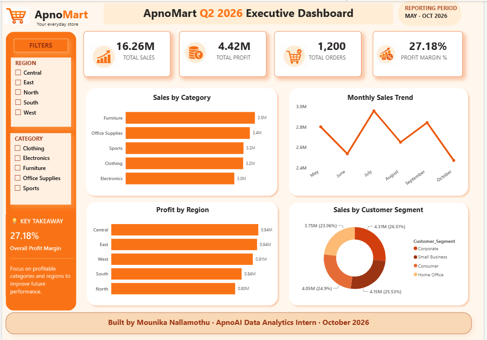

# ApnoMart Insight Board — Business Intelligence Dashboard

**ApnoAI Data Analytics Internship | October 2026**

## Project Overview

This project analyzes ApnoMart's sales data using Power BI to understand revenue performance, profitability, and customer behavior. The interactive dashboard presents key performance indicators and visual insights to support business decisions for the next quarter.

## Dashboard Preview

## Tool Used

- Power BI Desktop
- CSV dataset containing 1,200 sales records

## Dashboard Features

- KPI cards: Total Sales, Total Profit, Total Orders, and Profit Margin
- Sales by Category
- Monthly Sales Trend
- Profit by Region
- Sales by Customer Segment
- Interactive Region and Category slicers
- Key Takeaway panel

## Key Insights

1. **Revenue Pattern:** Furniture is the leading category, generating approximately 3.52M in sales (21.63% of total revenue).
2. **Profitability Pattern:** Office Supplies has the highest category profit margin at 34.80%, while Electronics has the lowest at 18.88%.
3. **Customer Behavior Pattern:** Corporate customers contribute approximately 4.31M (26.51% of total sales), making them the largest customer segment.

## Strategic Recommendation

Review Electronics pricing, discounts, and costs while using Office Supplies as a benchmark for stronger category profitability. Monitor sales and profit margins together when adjusting discount policies.

## Project Files

- `apnomart_dashboard.png` — Power BI dashboard screenshot
- `insights.pdf` — Executive insights and strategic recommendation
- `ApnoMart_Insight_Board.pdf` — Dashboard PDF export
- `ApnoMart_Insight_Board.pbix` — Power BI report file

## Author

**Mounika Nallamothu**

ApnoAI Data Analytics Intern · October 2026
